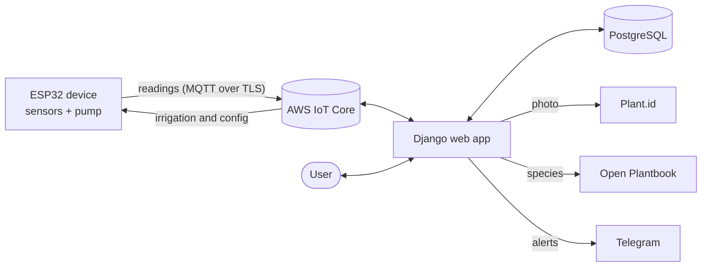

<p align="center">
  
</p>

<h1 align="center">SmartPlant</h1>

<p align="center">
  <em>Take a photo of your plant. SmartPlant recognises it, learns what it needs, and looks after it.</em>
</p>

<p align="center">
  
  
  
  
  
  
  
</p>

---

## Table of Contents

- [About](#about)
- [Features](#features)
- [How It Works](#how-it-works)
- [Hardware](#hardware)
- [Repository Structure](#repository-structure)
- [Getting Started](#getting-started)
- [Tests](#tests)
- [Author](#author)

---

## About

SmartPlant is an IoT system for monitoring and watering house plants. An ESP32 device sits next to the plant and measures its environment; a web application shows the readings, raises alerts and drives the water pump.

What sets it apart is the setup: you do not enter thresholds by hand. You upload a photo, the platform identifies the species, and the correct ranges for temperature, humidity, soil moisture and light are filled in automatically.

---

## Features

**Plant recognition and automatic care profile**
- Identifies the species from a photo ([Plant.id](https://plant.id)).
- Retrieves the ideal care parameters for that species ([Open Plantbook](https://open.plantbook.io)) and uses them as alert thresholds.
- Caches care profiles locally, so a known species needs no second lookup.
- Thresholds stay editable if you want to tune them.

**Live monitoring**
- Dashboard with every registered plant and its latest readings.
- Detail page per plant with the history of temperature, air humidity, soil moisture and light.
- Readings also shown on the device's own OLED display.

**Irrigation**
- Manual watering from the web interface.
- Automatic watering on a schedule that follows the species' needs (from every 2 days to every 14).
- Log of every irrigation, manual or automatic.

**Alerts**
- Telegram message when a reading leaves its range, with at most one alert per plant per hour.
- Telegram notification after each automatic irrigation.

**Accounts and devices**
- User registration, login and profile.
- Devices are paired to an account with a 6-digit PIN.
- Admin area to manage users and devices and to regenerate PINs.

---

## How It Works



1. The device reads its sensors once an hour and publishes each value on `smartplant/<device_id>/<sensor>`.
2. The web app listens to those topics, stores the readings and compares them with the plant's thresholds.
3. Out-of-range values trigger a Telegram alert.
4. Irrigation commands, manual or scheduled, travel back to the device, which switches the pump relay for the requested time.

---

## Hardware

| Component | Role | Pin |
|---|---|---|
| ESP32 (uPesy Wroom) | Microcontroller, Wi-Fi | |
| DHT11 | Air temperature and humidity | GPIO 22 |
| Soil moisture sensor | Soil moisture (%) | GPIO 35 |
| Light sensor | Ambient light | GPIO 36 |
| Water sensor | Water detection | GPIO 34 |
| Relay + pump | Irrigation | GPIO 27 |
| SSD1306 OLED (128x64) | Local display | SDA 23, SCL 4 |

On first boot the device opens a Wi-Fi access point named `<device_id>-Setup`: connect to it to enter your network credentials, no reflashing needed.

---

## Repository Structure

```text
.
├── ESP32Code/                 # Firmware (PlatformIO, Arduino framework)
│   ├── src/main.cpp           # Setup and main loop
│   ├── lib/utils/             # Sensors, MQTT, display, irrigation
│   └── sync_env.py            # Injects .env values and certificates at build time
│
├── SmartPlantManager/         # Django project
│   ├── accounts/              # Users, login, profile, admin area
│   ├── plants/                # Plants, devices, MQTT client, alerts, irrigation
│   └── shared/                # Base templates, common CSS and JS
│
├── docker-compose.yml         # Django + PostgreSQL + Cloudflare tunnel
├── Dockerfile
├── start.sh                   # Builds, starts and prints the public URL
└── .envTemplate               # Configuration template
```

---

## Getting Started

### Requirements

- Docker and Docker Compose
- An AWS IoT Core endpoint with a device certificate
- A Telegram bot token
- API keys for Plant.id and Open Plantbook
- PlatformIO, to flash the ESP32

### 1. Configure

```bash
git clone https://github.com/Pandanna/SmartPlant.git
cd SmartPlant
cp .envTemplate .env
```

Fill in `.env`, then place the AWS IoT certificates in a `certs/` folder:

```text
certs/
├── rootCA.pem
├── device.crt
└── private.key
```

### 2. Start the web app

```bash
./start.sh
```

The script builds the containers, applies the database migrations, creates the admin user and prints a public URL through a Cloudflare tunnel. The app is also available at `http://localhost:8000/login/`.

### 3. Flash the device

```bash
cd ESP32Code
pio run --target upload
```

The build reads the endpoint and the certificates from `.env` and `certs/`, so the firmware needs no manual editing.

### 4. Register your plant

1. Log in as admin and create a device: you get its 6-digit PIN.
2. From your account choose **Register**, enter the device ID and PIN.
3. Upload a photo of the plant and confirm the suggested species and thresholds.

---

## Tests

The project includes 92 automated tests covering authentication, the dashboard, thresholds, alerts, irrigation, MQTT message handling and the external services.

```bash
cd SmartPlantManager
python manage.py test --settings=SmartPlantManager.settings_test
```

